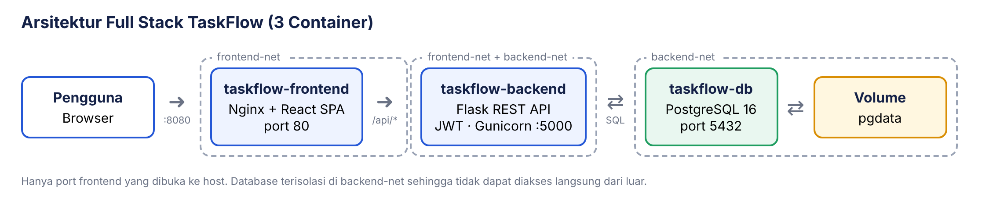
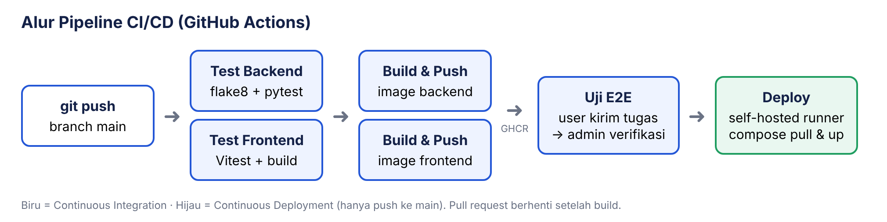

# TaskFlow — Aplikasi Full Stack dengan Container & CI/CD

Aplikasi web **full stack** untuk pengumpulan dan verifikasi tugas dengan dua peran:
**User** mengirim tugas (judul + deskripsi), **Admin** memeriksa lalu menandainya selesai,
dan status di akun User berubah menjadi **Selesai**.

| Lapisan | Teknologi | Container |
|---|---|---|
| Frontend | React 19 + Vite, disajikan Nginx (juga reverse proxy `/api`) | `taskflow-frontend` |
| Backend | Flask 3 REST API, autentikasi JWT, Gunicorn | `taskflow-backend` |
| Database | PostgreSQL 16 + volume persisten | `taskflow-db` |



Dikemas dengan **Docker & Podman** dan dideploy otomatis oleh **GitHub Actions**.
UTS Mata Kuliah **Pengembangan dan Operasi** — **Kelompok Blueprints**, Kelas IF B Sore, Universitas Mikroskil.

| No | Nama | NIM |
|----|------|-----|
| 1 | Nanda Fachriza Artin | 231112189 |
| 2 | Arman Maulana | 231110155 |
| 3 | Nyoto Prasetyo | 231110255 |
| 4 | Mhd. Abi Manyu | 231112549 |
| 5 | Celvin | 231110656 |

## Struktur
```
backend/                Flask API (app/, tests/, Dockerfile)
frontend/               React SPA (src/, nginx.conf.template, Dockerfile)
docker-compose.yml      stack 3 container (Docker Compose / podman-compose)
podman/                 Podman Pod & podman kube play
.github/workflows/      pipeline CI/CD
deploy/SETUP-RUNNER.md panduan komputer server CD (self-hosted runner)
```

## Menjalankan
**Paling mudah (Windows):** double-click `JALANKAN.bat` — otomatis install, menyalakan backend & frontend, lalu membuka http://localhost:5173. Syarat: Python 3.12 dan Node.js sudah terpasang.

```bash
# Docker
cp .env.example .env                  # Windows CMD: copy .env.example .env
docker compose up -d --build          # buka http://localhost:8080

# Podman
podman-compose up -d --build          # atau
bash podman/taskflow-pod.sh           # atau podman kube play podman/taskflow-kube.yaml

# Development tanpa container
cd backend && pip install -r requirements-dev.txt && python wsgi.py   # :5000
cd frontend && npm install && npm run dev                             # :5173
```

## API
| Method | Endpoint | Auth |
|---|---|---|
| POST | /api/auth/register, /api/auth/login | – |
| GET | /api/auth/me | JWT |
| GET/POST | /api/tasks | JWT |
| GET | /api/tasks/stats | JWT |
| GET/PATCH/DELETE | /api/tasks/{id} | JWT (user) |
| GET | /api/admin/tasks?status=menunggu\|selesai | JWT (admin) |
| GET | /api/admin/stats | JWT (admin) |
| PATCH | /api/admin/tasks/{id} `{"done": true}` | JWT (admin) |
| GET | /api/health | – |

## Peran pengguna
| Peran | Kemampuan |
|---|---|
| **User** | Daftar akun, kirim tugas (judul + deskripsi), memantau status *Menunggu review* / *Selesai* |
| **Admin** | Melihat semua tugas dari semua user, mengecek deskripsi, menandai selesai atau membatalkan |

Akun admin awal dibuat otomatis dari `ADMIN_EMAIL` / `ADMIN_PASSWORD`
(bawaan: `admin@taskflow.id` / `admin123` — ganti untuk production).

## CI/CD


Push ke `main`: test backend & frontend → build 2 image → push ke GHCR →
uji end-to-end seluruh stack → **deploy otomatis ke komputer kelompok** (GitHub
self-hosted runner + Docker Desktop) → cek `/api/health`.
Pull request hanya menjalankan test dan build.

Panduan menyiapkan runner: [deploy/SETUP-RUNNER.md](deploy/SETUP-RUNNER.md).
